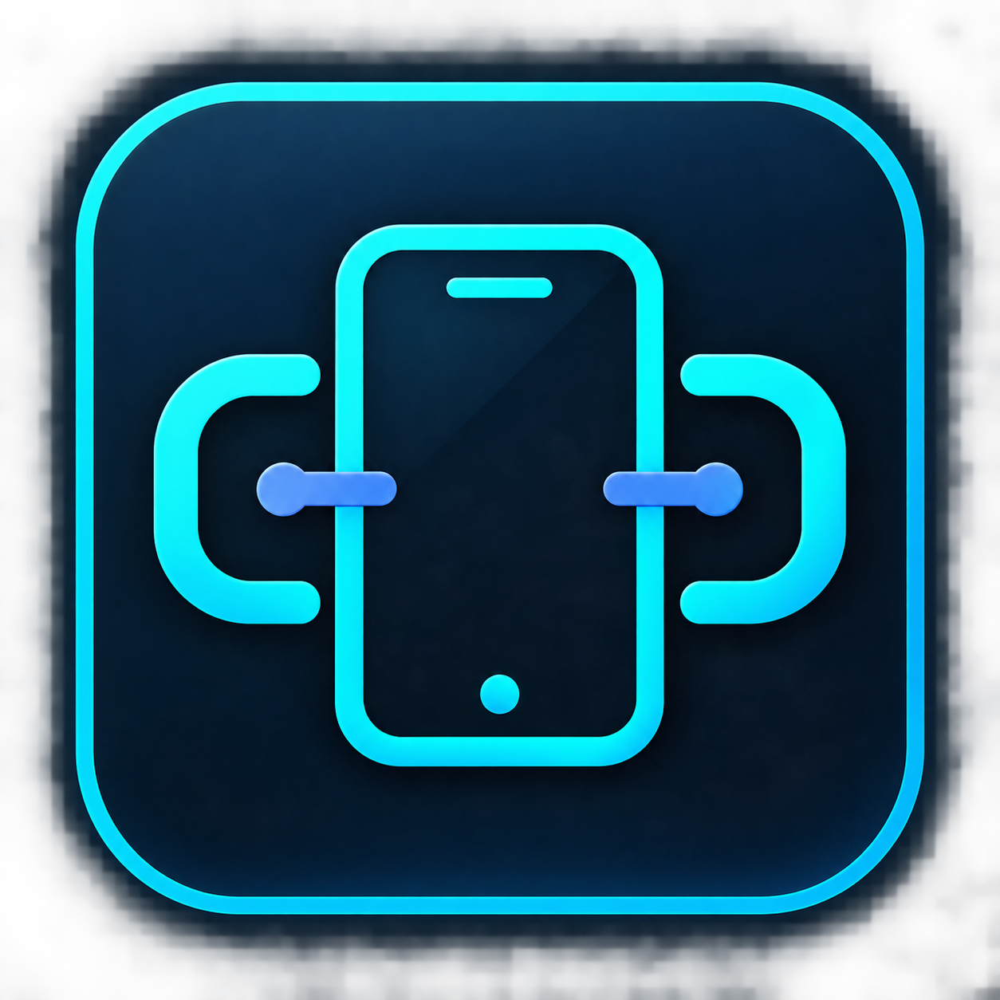
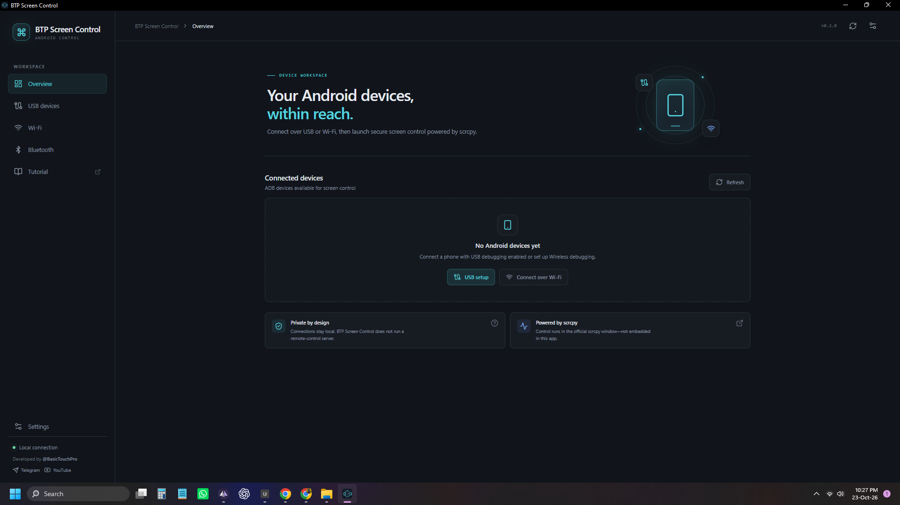
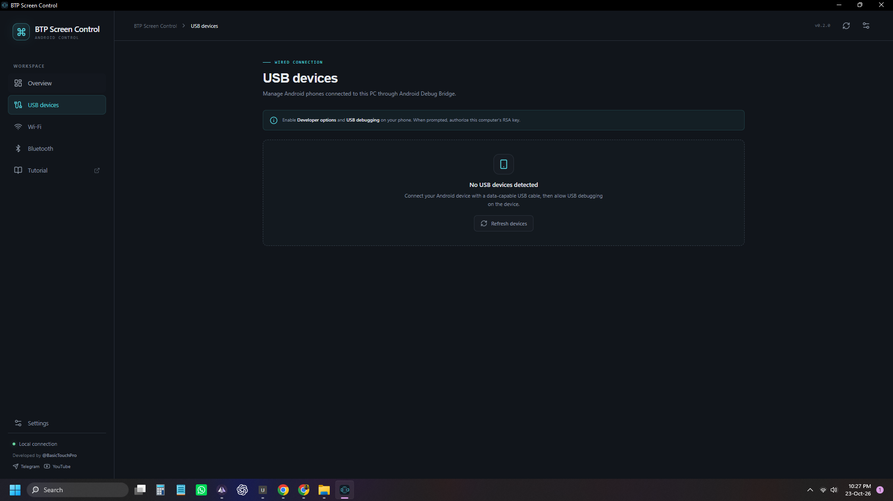
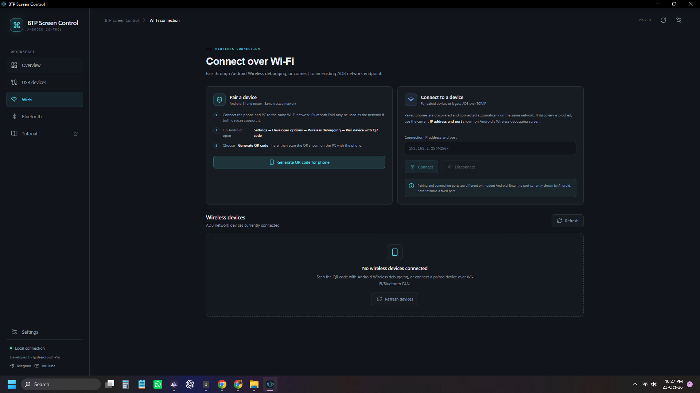
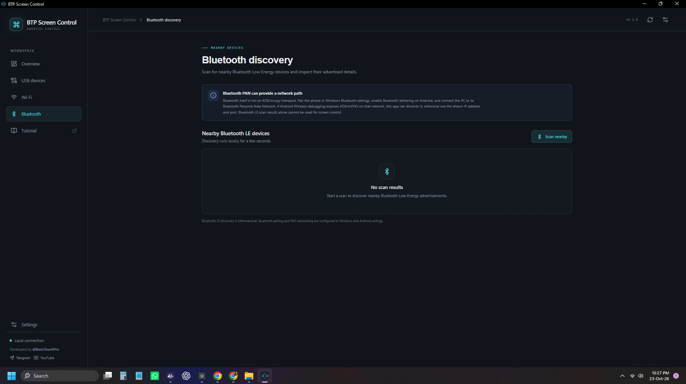
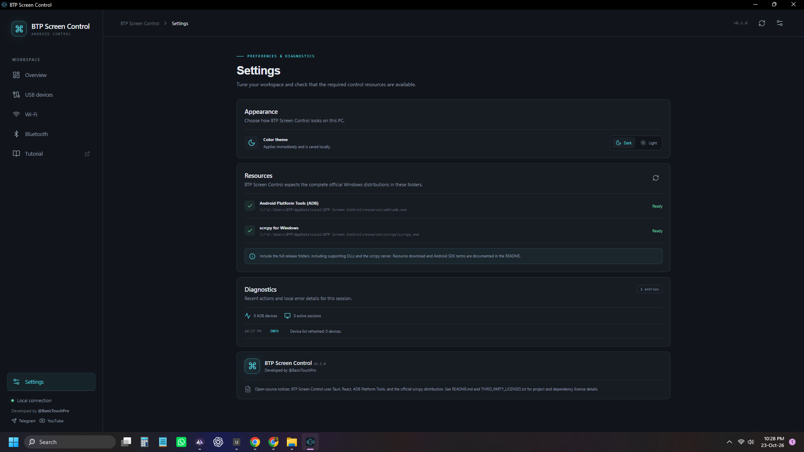

# BTP Screen Control

<p align="center">
  
</p>

<h3 align="center">Control your Android phone from your Windows PC.</h3>

<p align="center">
  Mirror your phone screen, manage connected Android devices, and launch screen control sessions from one dedicated desktop application.
</p>

<p align="center">
  <a href="https://github.com/YOUR_USERNAME/YOUR_REPOSITORY/releases/latest/download/BTP.Screen.Control_0.2.0_x64-setup.exe">
    
  </a>
</p>

<p align="center">
  
  
  
  
</p>

---

## Overview

**BTP Screen Control** is a Windows desktop application developed by **[BasicTouchPro](https://www.youtube.com/@BasicTouchPro)** for connecting to, mirroring, and controlling Android devices directly from a computer.

It provides a unified workspace for discovering connected Android devices, establishing USB or wireless ADB connections, and launching dedicated control windows powered by the official scrcpy distribution.

Whether you use a desktop PC or a laptop, BTP Screen Control provides a convenient interface for managing your Android device from Windows.

## Features

- **Screen Mirroring** — View your Android phone's screen on your computer.
- **Phone Control from PC** — Interact with your Android device through a separate control window powered by scrcpy.
- **USB Connection** — Discover and manage Android devices connected through a USB data cable.
- **Wireless Connection** — Pair and connect supported Android devices over Wi-Fi using Android Wireless Debugging.
- **Bluetooth PAN Support** — Attempt an ADB network connection through a Bluetooth Personal Area Network when supported by the phone and network.
- **Bluetooth LE Discovery** — Scan nearby Bluetooth Low Energy advertisements and inspect available device information.
- **Device Management** — Refresh connected devices and manage devices hidden from the application list.
- **QR Code Pairing** — Generate a QR code to simplify supported Android Wireless Debugging pairing.
- **Dark and Light Themes** — Choose the appearance that suits your workspace.
- **Resource Diagnostics** — Check required ADB and scrcpy resources and review local diagnostic information.
- **Local Connections** — Designed for direct local device connections rather than a remote-control server.

## Screenshots

The following screenshots show the application's interface and main features.

| Overview | USB Devices |
|---|---|
|  |  |

| Wi-Fi Connection | Bluetooth Discovery |
|---|---|
|  |  |

| Settings and Diagnostics |
|---|
|  |

> **Note:** Add your screenshots to the `screenshots/` folder using the filenames shown above. Until these files are uploaded, the screenshot images will not display. You can remove this section if you do not want to publish screenshots yet.

## Download

### Latest Windows Release

Download the installer for Windows:

**[Download BTP Screen Control v0.2.0 (.exe)](https://github.com/YOUR_USERNAME/YOUR_REPOSITORY/releases/latest/download/BTP.Screen.Control_0.2.0_x64-setup.exe)**

- **Application:** BTP Screen Control
- **Version:** 0.2.0
- **Package:** Windows installer (.exe)
- **Architecture:** x64

For other versions and release information, visit the [Releases page](https://github.com/YOUR_USERNAME/YOUR_REPOSITORY/releases).

> Replace `YOUR_USERNAME` and `YOUR_REPOSITORY` in the download links with your actual GitHub username and repository name. The installer filename must match the asset uploaded to the published release.

## System Requirements

- **Operating System:** Windows 10 or Windows 11 (64-bit).
- **Device:** Desktop PC or laptop.
- **Phone:** Compatible Android device.
- **Connection:** USB or supported wireless connection.
- **Requirements:** ADB and the required scrcpy resources included with the application.

**Compatibility:** The application has been tested on Windows 10 and Windows 11.

## Installation

1. Open the latest release using the download link above.
2. Download `BTP.Screen.Control_0.2.0_x64-setup.exe`.
3. Run the installer and follow the on-screen instructions.
4. Launch BTP Screen Control.
5. Connect your Android phone using USB or a supported wireless connection.
6. Follow the instructions shown in the application.

If Windows displays a security warning, verify that the installer was downloaded from the official repository and review the publisher information before proceeding. The project does not claim that the installer is code-signed.

## Connect Your Android Phone

### USB Connection

1. Open **Settings → About phone** on your Android device.
2. Enable **Developer options** and **USB debugging**.
3. Connect the phone to your computer using a data-capable USB cable.
4. Unlock the phone and approve the USB debugging authorization prompt.
5. Open BTP Screen Control and select **USB devices**.
6. Refresh the device list and launch the control window for your device.

If the device appears as `unauthorized`, approve the authorization prompt on your phone.

### Wi-Fi Connection

For supported Android devices, Wireless Debugging can be used to establish a connection without keeping a USB cable connected.

1. Connect your computer and phone to the same trusted Wi-Fi network.
2. On Android 11 or later, open **Developer options → Wireless debugging**.
3. Select **Pair device with QR code**.
4. In BTP Screen Control, open **Wi-Fi** and choose **Generate QR code for phone**.
5. Scan the QR code using the phone's Wireless Debugging pairing interface.
6. Keep the pairing screen open while discovery and pairing complete.

If automatic discovery does not work, use the current IP address and connection port displayed on the Android Wireless Debugging screen.

**Important:** The pairing port and connection port are different. Use the connection port when manually connecting to an already paired device.

Network isolation, firewall rules, and mDNS availability can affect wireless discovery.

### Bluetooth PAN

Bluetooth LE discovery is intended to inspect nearby Bluetooth Low Energy advertisements. Bluetooth itself is not an ADB or scrcpy transport.

For a possible Bluetooth network connection:

1. Pair the phone with Windows through Bluetooth settings.
2. Enable Bluetooth tethering on Android if supported.
3. Connect the computer to the phone's Bluetooth Personal Area Network (PAN).
4. If Android exposes ADB and mDNS on that network, attempt discovery or use the current connection IP address and port.

Bluetooth PAN availability varies by device, Android version, and Windows adapter. Bluetooth LE scanning alone does not enable screen mirroring or phone control.

## Privacy and Connectivity

BTP Screen Control is designed around local connections between your computer and Android device.

- The application does not require a user account or sign-up according to the current project design.
- The application interface identifies the connection model as local and does not describe a remote-control server.
- Screen control uses the bundled scrcpy distribution and ADB resources.
- Network connections may be used for supported wireless device communication on your local network.
- Bluetooth discovery scans for nearby BLE advertisements when requested.

These statements describe the intended application design. Review the source code and bundled dependencies to independently verify application behavior.

## Troubleshooting

| Problem | What to check |
|---|---|
| No USB device detected | Check the USB cable, USB debugging, phone authorization, and manufacturer USB drivers. |
| Device is unauthorized | Unlock the phone and approve the USB debugging RSA prompt. |
| Wi-Fi pairing fails | Keep the Wireless Debugging pairing screen open and check that both devices share a trusted network. |
| Wireless discovery fails | Check Windows Firewall, local network restrictions, and mDNS availability. |
| Manual wireless connection fails | Verify that you entered the current connection port, not the pairing port. |
| ADB or scrcpy resources are missing | Restore the complete resource folders, including required DLLs and the scrcpy server. |
| Control window closes unexpectedly | Check device authorization, ADB status, resource files, and Settings → Diagnostics. |
| Bluetooth PAN connection fails | Confirm tethering is enabled and that the phone exposes ADB connectivity through the PAN. |

## Development

BTP Screen Control is built using Tauri, React, Rust, and supporting Windows and Android device tools.

To build the application from source, the project documentation specifies the following development prerequisites:

- Node.js LTS and npm.
- Rust stable with the MSVC target.
- Microsoft C++ Build Tools with **Desktop development with C++**.
- Microsoft Edge WebView2 Runtime.
- The required ADB and complete official Windows scrcpy resource files.

After installing the prerequisites, open an appropriate Visual Studio developer terminal and run:

```powershell
npm ci
npm run tauri dev
```

To check the frontend and Rust components:

```powershell
npm run build
cargo check --manifest-path src-tauri/Cargo.toml
```

To build a Windows release installer:

```powershell
npm run tauri build
```

The exact output locations depend on the project's Tauri configuration. Verify the generated installer and its bundled resources before distribution.

## Project Resources and Third-Party Licenses

BTP Screen Control relies on third-party software and libraries, including scrcpy, ADB-related resources, React, and Tauri.

These components are subject to their respective licenses and notices. Please review:

- [`LICENSE`](./LICENSE) — the project's stated license.
- [`THIRD_PARTY_LICENSES.txt`](./THIRD_PARTY_LICENSES.txt) — third-party license references and notices.
- [`resources/resource-manifest.json`](./resources/resource-manifest.json) — resource provenance and version information, if included in the repository.

Preserve upstream license files and notices when distributing third-party binaries. Verify the applicable license terms before redistributing bundled components.

## Contributing

Bug reports, suggestions, and feedback are welcome. Please include your Windows version, connection method, Android version, and relevant diagnostic details when reporting an issue. Do not include passwords, private keys, or other sensitive information.

## Developer

<p align="center">
  <strong>Developed with care by BasicTouchPro</strong>
</p>

<p align="center">
  <a href="https://www.youtube.com/@BasicTouchPro">
    
  </a>
  &nbsp;
  <a href="https://t.me/BasicTouchPro">
    
  </a>
</p>

---

## License

This project includes an MIT License notice.
Please review the [LICENSE](./LICENSE) file and the
applicable licenses of all bundled third-party components
before redistributing the application.

---

<p align="center">
  Made with care by
  <a href="https://www.youtube.com/@BasicTouchPro">
    <strong>BasicTouchPro</strong>
  </a>
</p>
